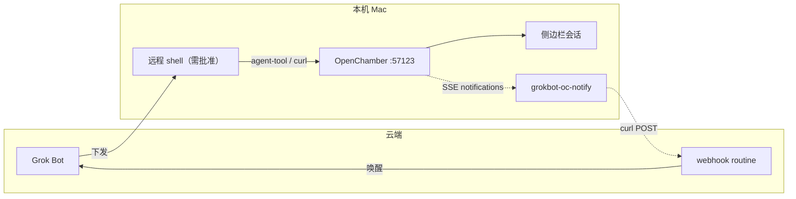

# openchamber-grokbot

云端 Grok Bot 通过本机 [OpenChamber](https://openchamber.dev) 的 HTTP API 开/控侧边栏可见的编程会话。会话结束、报错、提问或要权限时，旁路 watcher 把摘要 POST 给 webhook routine，再唤醒 Grok Bot。

对照 [herdr-grokbot](sand-workflow:herdr-grokbot)：herdr 用 pane CLI + `grokbot-notify.sh` 轮询 agent 状态；OpenChamber **自带**桌面/推送通知与 SSE，但**没有**开箱「POST 到外部 Grok Bot webhook」——本 skill 的 watcher 补这一环。

## 架构



循环：Grok Bot 经 agent-tool 建会话 / `session.send` → 用户在侧边栏可见 → 跑完或 blocked → watcher POST → routine 唤醒 → 决定续跑、转交或回用户。

## Webhook 路由（硬约定）

**默认与 herdr 共用同一 `GROKBOT_WEBHOOK`**（软链 `~/.config/openchamber/grokbot-webhook.env` → herdr env）。接收方是「herdr 本机 agent 回调」例程，按 payload 的 `source=openchamber` + `directory` / `projectId` / `title` 分流（ageval / Agentero / 测试目录 FYI）。**不要**擅自改成 openchamber 例程自己的 URL，除非用户当面要求拆开。

因此 payload **必须**富化到能路由：非空 `directory`，最好有 `title` / `projectId`（或 `project`）/ `outcome` / `agent`。纯 `session`+`idle` 且无目录 → 接收方只会忽略或一句 FYI，不会盲转。

## 本机前提

- OpenChamber.app 在跑（默认本地端口见 `~/.config/openchamber/settings.json` 的 `desktopLocalPort`，常见 `57123`）。
- Webhook 环境文件（与 herdr 共用）：

```bash
# 推荐：软链到已有 herdr 凭证
ln -sf ~/.config/herdr/grokbot-webhook.env ~/.config/openchamber/grokbot-webhook.env
# 或自建，键名相同：
# GROKBOT_WEBHOOK="https://…"
# GROKBOT_AUTH="Bearer <sender-key>"
```

值必须加引号。`GROKBOT_AUTH` 用 `Bearer ` 前缀；脚本缺前缀时会补。URL / Authorization 只放 env，不要贴进聊天。

- Watcher（已装在 MBP / Mini 约定路径）：

```bash
~/.config/openchamber/bin/grokbot-oc-notify.sh
# 可选：SSE 挂了时轮询
~/.config/openchamber/bin/grokbot-oc-notify.sh --poll-seconds 30
# 冒烟（走真实 /api/notifications/emit，可加 --once-dry-run）
~/.config/openchamber/bin/grokbot-oc-notify.sh --smoke --duration 15 --once-dry-run
```

主逻辑：`grokbot-oc-notify.py`。状态文件 / 日志：`~/.config/openchamber/run/oc-notify.state.json`、`oc-notify.log`。可选 launchd 草稿：`~/.config/openchamber/run/com.zhuo.grokbot-oc-notify.plist.draft`（默认未 load）。

## Agent-tool（起停会话）

Managed OpenCode 子进程注入：

- `OPENCHAMBER_AGENT_TOOL_URL` → 通常 `http://127.0.0.1:57123/api/openchamber/agent-tool`
- `OPENCHAMBER_AGENT_TOOL_TOKEN` → Bearer

可从 `opencode serve --hostname 127.0.0.1 --port 62073` 的进程环境取出，写入 `~/.config/openchamber/run/agent-tool.env`（0600）。Token 会随 OpenChamber 重启变化，用前先刷新。

**请求体必须是** `{ "input": { "action": "…", … } }`，不要把 `action` 放在顶层。

常用 action（以本机 tool 描述为准）：`session.list` / `session.create` / `session.send` / `session.status` / `session.messages` / `projects.list`。创建或 fork 出的会话属于用户，会出现在侧边栏。

字段名注意：`sessionId`（不是 `sessionID`）。`model` 必须是字符串 `"provider/model"`（如 `"xai/grok-4.7"`）；分开传 providerID/modelID 会被忽略。

只读探活也可不带 token：`GET http://127.0.0.1:57123/api/session`。

## 回调信号

Watcher 优先听 OpenChamber SSE：

1. **主**：`/api/notifications/stream`（与桌面「跑完 / 出错 / 提问 / 要权限」同源）
2. **辅**：`/api/event` 或 `/api/global/event` 上的 `session.status` busy→idle 边沿
3. **兜底**：`--poll-seconds` 轮询 `/api/sessions/status`

冒烟可用官方 `POST /api/notifications/emit`（本机实测无需额外 auth，`delivered: true`）；emit 会把 kind 收成 `plugin`，映射成 `done`——真实桌面通知 kind/title 更具体。

POST 前用 `GET /api/session/{id}` 富化元数据（`location.directory`、`projectID`、`title`、`outcome`、`agent`）。poll 边沿若 `status=idle` 且 `outcome=succeeded`，对外标成 `status=done`。

POST 到 webhook 的 JSON 形状：

```json
{
  "source": "openchamber",
  "session": "<id>",
  "status": "done|blocked|error|question|permission|idle",
  "title": "…",
  "text": "…",
  "directory": "…",
  "projectId": "…",
  "outcome": "succeeded|failed|…",
  "agent": "…",
  "event": "<sse type>"
}
```

与 herdr 的 `{agent, status, text}` 并列：用 `source` 区分。幂等：同一 `session|status|tag` 只叫醒一次，直到会话重新进入 busy 周期；首次连接会 seed，避免历史噪声。

## 操作要点（给执行这条 skill 的 Bot）

1. 先确认 OpenChamber 在听（`curl -sS -m 2 http://127.0.0.1:57123/api/sessions/status`），再 agent-tool。
2. 远程 shell 一律用户批准；PATH 不稳时用 `/bin/bash -lc 'export PATH=/usr/bin:/bin:/opt/homebrew/bin:…'`。
3. 长任务前确认本机 `grokbot-oc-notify.sh` 在跑；未配 webhook 则自己读 `/api/session/...` / messages 摘要回用户。
4. 不要改用户全局 OpenChamber / OpenCode 配置来迁就单次任务；原生模型参数走会话/项目自己的设置。
5. Cursor Cloud Agent、herdr pane 回路仍走各自 skill；本 skill 只覆盖 OpenChamber HTTP + 自建回调。
6. Feishu 等其它通道规则不变；webhook URL / token 永不进聊天。
7. 共用 herdr webhook 时，测试会话用可识别的 title（如含 `oc-hook`）或放在明确测试目录（如 ob-notes），避免被当成正式 ageval/Agentero 任务转交。

## 不要

- 假设 OpenChamber 会像 herdr notify 一样主动打 Grok Bot webhook（不会；必须跑 watcher）。
- 把 agent-tool 的 `action` 放在 JSON 顶层。
- 在聊天里打印 `OPENCHAMBER_AGENT_TOOL_TOKEN` / `OPENCODE_SERVER_PASSWORD` / webhook secret。
- 未确认安全就代点权限；OC 的 permission 通知应唤醒 Bot 后由用户或明确授权处理。
- 擅自把 OC 回调改到单独 openchamber webhook URL（默认共用 herdr）。
