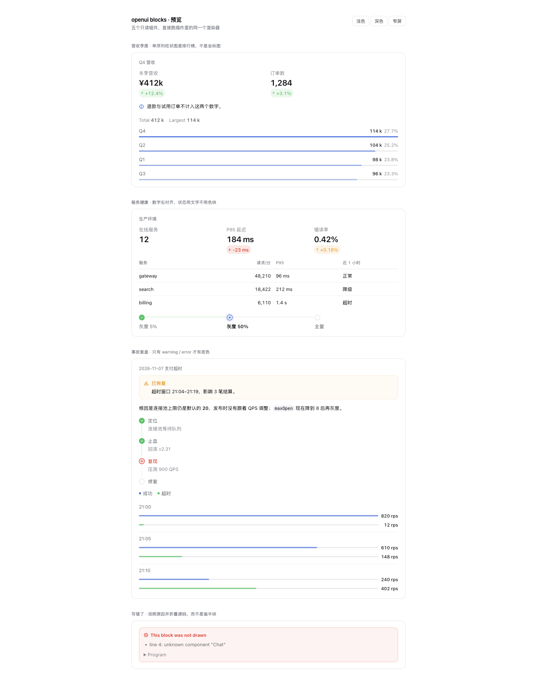

# @fstack/dsh-openui-blocks

UI blocks for DeepSeek Harness: the model writes a short openui-lang program in a
tool call, and the chat draws it with the harness's own type scale, tokens and
chart rules — instead of a paragraph that describes what a chart would have
shown.

v0.1.0 draws the read-only half of an answer: `Stat`, `Table`, `BarChart`,
`Steps`, `Callout` (plus `Stack`, `Row`, `Text`, and `Series` as a chart
argument). Inputs, choices and the answer channel are the next increment.



## Install

Not on npm yet — install it from a checkout of this repository:

```bash
git clone https://github.com/ffy6511/fstack.git
cd fstack
dsh plugin --profile desktop add ./dsh-plugins/openui-blocks-plugin
```

Use the profile you boot in place of `desktop`. A relative path is resolved from
the directory you run `dsh plugin` in, and the profile keeps a link to that
checkout — so keep the clone where it is (moving or deleting it breaks the
install).

Then **fully quit and reopen DSH** — the plugin set is locked at startup, and a
page refresh is not enough. Start a new session and ask for something a block
fits, e.g. *"把这个月的营收、订单和环比画成一块看板"*.

To uninstall:

```bash
dsh plugin --profile desktop remove @fstack/dsh-openui-blocks
```

## What the model writes

```
root = Stack([head, note, top])
head = Row([s1, s2])
s1 = Stat("Revenue", "¥412k", "+12.4%")
s2 = Stat("Orders", 1284, "+3.1%", "success")
note = Callout("Refunds are excluded from both figures.", "info")
top = BarChart(["Q1", "Q2", "Q3", "Q4"], [q], "k", true)
q = Series("Revenue", [98, 104, 96, 114])
```

| Component | Signature | Draws |
|---|---|---|
| `Stack` | `Stack(children)` | vertical stack; the root of every block |
| `Row` | `Row(children)` | equal columns that wrap |
| `Text` | `Text(text)` | a paragraph (`**bold**`, `` `code` ``) |
| `Callout` | `Callout(text, tone?, title?)` | note; only `warning`/`error` get a tinted box |
| `Stat` | `Stat(label, value, delta?, tone?)` | one number, its change |
| `Table` | `Table(columns, rows)` | a table; numeric columns right-align |
| `BarChart` | `BarChart(labels, series, unit?, whole?)` | ranked bars |
| `Series` | `Series(name, values)` | one series (`null` = missing point) |
| `Steps` | `Steps(items, direction?)` | a flow; `done \| current \| todo \| blocked` |

The parser is a strict subset: one statement per line, positional arguments,
no state, no expressions. Every error names the line, the component, the
argument index and the signature it should have matched, and that text is what
the model receives back — a rejected program is a repair instruction, not a
dead end.

## Design decisions

These are choices, not defaults; each one is the difference between "a card
widget" and "part of the answer".

- **No chrome.** A block renders bare inside the tool row: no card border, no
  header, no close button. The optional `title` is a 12px eyebrow, not a title
  bar.
- **Tokens only.** Every colour is a `--dsw-alias-*` alias and every type size a
  `--dsw-font-*` token, so light, dark and third-party themes all work without
  a dark-mode branch or a hard-coded palette.
- **One series is a ranking, not a plot.** `BarChart` with one series sorts
  descending and emphasises the leader by opacity step; several series keep
  label order and compare at equal weight with a legend. A trend belongs in a
  line chart, which is the next increment.
- **`whole` is explicit.** The total, the largest value and each share appear
  only when the author marks the values as parts of one whole; for averages or
  percentages a sum would be false, so it is never inferred.
- **Numbers right-align by column**, not cell — the rule readers use for tables
  of figures. Verdicts and names stay left.
- **Only warnings and errors are tinted.** Five tinted boxes in one answer read
  as stripes; a note is an icon and text.
- **Stats group themselves.** Consecutive `Stat`s in a `Stack` become one metric
  strip, so the model writes three statements instead of inventing a layout.
- **No dividers in the strip.** A wrapped row would leave a rule hanging at the
  start of the second line; typography separates the numbers instead.
- **The failure is visible.** A block that cannot be drawn shows the parser's
  reasons and folds its source, rather than disappearing or half-drawing.

## Layout

```
index.js              host half: the render_ui tool + its system-prompt section
client.js             built browser half (generated — do not edit)
src/catalog.js        the component catalog: parser, renderer and guidance share it
src/parse.js          openui-lang subset: lexer, parser, validation, diagnostics
src/guidance.js       the text a model reads, generated from the catalog
src/client/components.jsx  the renderer
src/client/styles.js  the stylesheet (tokens only)
preview/              a static harness that runs the same renderer
test/                 parser, renderer and both-half contract tests
```

`pnpm build` rebuilds `client.js`; `pnpm preview` builds and serves
`http://127.0.0.1:4517/` (`#dark` for the dark theme). `pnpm test` builds and
runs 22 tests, including one that loads `client.js` through
`window.__ModuleLoader__` and one that registers the host tool on a fake
registry.

## How the block reaches the transcript

The model calls `render_ui`; the host folds each call into the `openuiBlocks`
session projection with the turn it landed in. The fold reads the call's own
arguments from the log — there is no `openui/block` event. The client registers
one `conversation.chat.turnTail` entry, which draws that turn's blocks **under
the answer** once the turn ended with prose — the surface DSH already uses for
deliverables and action cards.

Two placement lessons are baked into that design:

- `tool.call.toolview` is the row of a tool call *inside the turn's folded
  process group*. A block drawn there is invisible until the reader expands an
  accordion that never advertised a picture.
- A `conversation.chat.node` is ordered by `anchorSeq`, and every node before the
  turn's closing answer is a process-group member — so a mid-turn block folds
  away there too.

The turn tail is outside both, and it is where a finished answer's artifacts
belong. Because the block is a pure function of the call's arguments, it replays
with the session and survives reload, fork and export with no store of its own.
The `tool.call.toolview` key stays registered as the expanded-Activity view of
the call that produced the block.

**No custom session event.** The harness's JSONL backend refuses to load a
session containing a stored event type it does not know unless the writer marked
it `ignorable`, and `session.append` cannot set that marker — only the
repo-internal `appendPluginRecord` can, for `plugin:` records. Writing an
`openui/block` event therefore made every session that contained one unreadable
(`contains event type "openui/block" (seq N) unknown to this harness and not
marked ignorable`). Deriving the block from the existing `tool/call` event keeps
the log inside the harness vocabulary, so there is nothing to migrate and old
sessions fold the same way.

## Why a tool call and not a markdown fence

The harness's markdown renderer has no fence extension point (`MarkdownText`
takes only `fileMentions` and `codeLabels`, and its DOM is pinned by fixtures),
so a ` ```openui ` block would have to be produced by patching the renderer or
post-processing its DOM. The supported seam is `tool.call.toolview`: the model
calls `render_ui`, the call's arguments live in the session log, and the block is
a pure function of them — reload, replay and fork redraw it with no store and no
DOM surgery.

The visible cost: the model has to spend a tool call, and the block is its own
row rather than a paragraph-level fence. That is the trade this version makes.

## What is verified

- 22 tests pass: parser diagnostics, renderer output, host registration on a
  real `defineTool`, and the shipped bundle loading through the module loader
  and claiming the `render_ui` key.
- The preview renders the shipped renderer at 760px and 390px, light and dark.
- **Not verified:** the block inside a live DSH turn. That needs the plugin
  installed and the app restarted.

## Attribution

The design decisions above were adapted from
[OpenChamber](https://github.com/openchamber/openchamber)'s UI blocks (MIT,
Copyright (c) 2025 Bohdan Triapitsyn) — the catalog-as-single-source approach,
the chart and stat rules, and the "a block never shows with parts silently
dropped" principle. The openui-lang surface follows
[`@openuidev/lang-core`](https://www.npmjs.com/package/@openuidev/lang-core)
(MIT), but this package ships its own small parser for the nine components it
supports: no runtime dependency, no install-time postinstall, and a bundle that
stays under 60 kB.

MIT.
