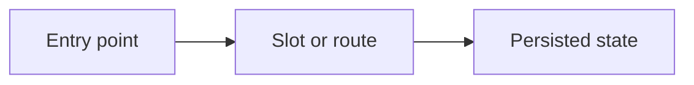

# File GitHub Issue

Write an issue a stranger-agent can execute from. The chat is not attached.

Do **not** start implementation unless the user said to implement as well.
If anything is unclear, call AskUserQuestion and wait before creating the issue.

## Defaults

- **English** title and body. Switch language only if the user says so, or the repo's issue templates / recent issues are clearly not English and the user did not specify.
- **Create** the issue (do not stop at a draft) unless the user asked for a draft only.
- One issue per independent increment. Split if two approaches or two ownership areas.

## Workflow

### 1. Resolve the repo

From the workspace: `git remote -v`, `gh repo view`. Prefer the **canonical / upstream** repo the team files issues on (org remote with write access), not a personal fork, unless the user named a repo.

If remotes disagree or write access is missing, stop and say which repo you would use.

### 2. Load the project's taxonomy (required)

Read what this repo already uses. Do not invent labels.

1. `.github/ISSUE_TEMPLATE/*` — **check this first**. If any template exists, its headings, required fields, title prefix, and default labels are authoritative; the body follows the template, not the shape below.
2. `gh label list --repo OWNER/REPO`.
3. A few recent issues: title style and which labels actually get applied.

Only when no issue template exists does the skill's own shape apply.

Pick from that set:

| Slot | What to take |
| --- | --- |
| **Kind** | Exactly one: `Feat` / `Fix` / `Bug` / `Docs` / `Chore` / `question`, or `type:feat` / `type:fix` if that is the repo's scheme. Match the template. |
| **Area** | Every material surface: `area:runtime`, `area:config`, … Only labels that exist. |
| **Priority** | `p0` / `p1` / `p2` only if the repo defines them and the user implied urgency. Default `p2` when that label exists and nothing was said. |

Title follows the repo (often `feat(scope): …` or the template's `feat: ` prefix).

### 3. Draft a self-contained body

A later agent must understand **problem + intended change** from this issue alone.

When the repo has an issue template, fill its headings and required fields; do not replace them with the shape below. Only when no template exists, use this shape:

1. **Problem** — what is true today, why it hurts, who hits it. Cite current code/docs with **repo-relative** paths. Background and source analysis both belong here.
2. **Approach** — the agreed mechanism (which file, which knob, what default). One approach, not a menu. Split it into:
   - **Goals** — the outcome this issue must deliver.
   - **Non-goals** — what must not change; keep it short.
   - **Diagram (optional)** — a Mermaid diagram when the mechanism has more than one actor, step, or data path; skip it for a one-file change.

Design, API, and doc impacts go inside Approach as a short note, not as separate sections. Do not add Operator / API surface, Acceptance, or Pointers.

### 4. Public-issue hygiene (hard)

**Forbidden in title and body:**

- Absolute machine paths (`/Users/…`, `/home/…`, `C:\…`).
- Local-only names as if they were the product (`my Mac`, `this laptop`, Clash subscription URLs, LAN IPs used as the design).
- Secrets, tokens, API keys, `.env` values.
- Chat debris: "as we discussed", "in this session", "you said", uncommitted draft section numbers.

**Required form:**

- Paths: `src/…`, `docs/design/…`, `docker/attempt/build.py`.
- Hosts and products by public name (`pypi.org`, official base image tag), not a developer's disk layout.
- If a Dataset or example must be named, use the in-repo or published name, not a checkout path.

### 5. Create and return

```sh
gh issue create --repo OWNER/REPO --title "…" --label "A,B,C" --body-file -
```

If `gh` cannot write, say so; paste the title/body for the user to file. Do not open a personal-fork issue silently.

Reply with the issue URL and the labels applied. Do not dump the full body again.

## Tiny shape (only when the repo has no issue template)

````markdown
## Problem
…background, current behavior, and repo-relative source paths…

## Approach

### Goals
…

### Non-goals
…short…

<!-- Optional: keep only when the mechanism is not obvious from prose. -->

````

Do not add Operator / API surface, Acceptance, or Pointers sections.
